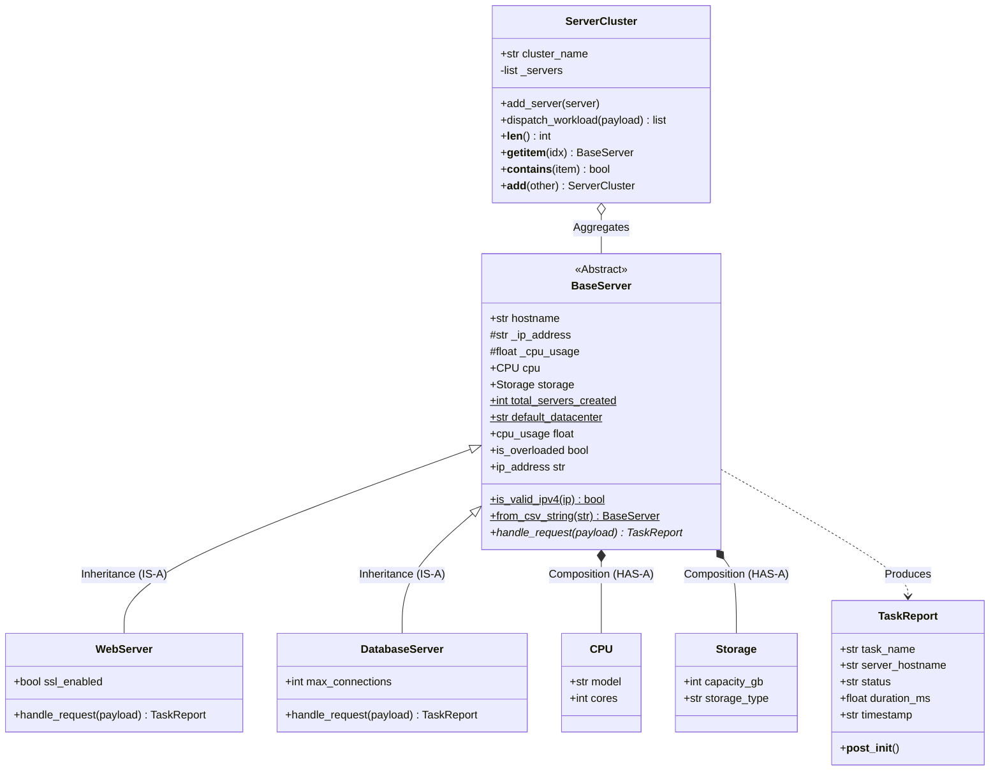

# Capstone Project: Cloud Fleet Orchestrator

Welcome to the Module 05 Capstone Project! In this intermediate-level project, you will combine all the Object-Oriented Programming (OOP) concepts learned across this module into a unified, modular system: **The Cloud Fleet Orchestrator**.

---

## 🌐 The Scenario

You are working as an infrastructure engineer at a cloud services provider. Your team needs a software system that manages fleets of servers deployed across global datacenters.

The system must:

1. **Model Hardware Components:** Servers are composed of independent hardware units like CPUs and Storage drives.
2. **Standardize Workload Reports:** Task execution records must use clean, typed data models without repetitive boilerplate.
3. **Enforce Interface Contracts:** All servers (Web Servers, Database Servers) must adhere to a strict base contract while processing workloads differently.
4. **Protect Internal State:** Server metrics (like CPU load and IP addresses) must be guarded against invalid inputs.
5. **Group and Orchestrate Nodes:** A cluster container must allow engineers to merge clusters, index servers, inspect capacity, and polymorphically dispatch jobs.

---

## 🏗️ System Architecture



---

## 🎯 Concepts Covered & Requirements

### 1. Modern Data Classes (`TaskReport` - Lesson 06)

* Defined using `@dataclass`.
* Holds `task_name`, `server_hostname`, `status`, `duration_ms`, and an automatic default `timestamp`.
* Uses `__post_init__` to validate that `duration_ms >= 0`.

### 2. Composition Over Inheritance (`CPU`, `Storage` - Lesson 05)

* Independent hardware classes representing hardware components.
* Rather than inheriting from hardware, `BaseServer` **contains** a `CPU` and `Storage` instance via Dependency Injection in its constructor.

### 3. Abstract Base Class Contract (`BaseServer` - Lesson 03)

* Inherits from `abc.ABC`.
* Declares the abstract method `@abstractmethod def handle_request(self, payload: str) -> TaskReport:`.
* Prevents direct instantiation of `BaseServer`.

### 4. Encapsulation & Properties (Lesson 02)

* `_cpu_usage` is protected.
* `@property def cpu_usage(self)` provides safe read access.
* `@cpu_usage.setter` enforces boundary rules (`0.0 <= value <= 100.0`), raising `ValueError` or `TypeError` if invalid.
* `@property def is_overloaded(self)` is a read-only computed property returning `True` when CPU usage exceeds `85.0%`.
* `_ip_address` is protected with a read-only `@property`.

### 5. Class & Static Methods (Lesson 01)

* **Class Attributes:** `total_servers_created` increments every time any server is initialized.
* **`@staticmethod is_valid_ipv4(ip)`:** Pure utility function checking for 4 valid octets between 0 and 255.
* **`@classmethod from_csv_string(cls, data_str)`:** Factory method parsing `"hostname,ip,cores,storage_gb"` to instantiate a server with composed components.

### 6. Subclasses & Polymorphism (Lesson 03)

* **`WebServer(BaseServer)`:** Adds `ssl_enabled` attribute. Overrides `handle_request()` to simulate HTTP/HTTPS request processing.
* **`DatabaseServer(BaseServer)`:** Adds `max_connections` attribute. Overrides `handle_request()` to simulate SQL query execution.
* Both use `super().__init__(...)` to avoid duplicating parent setup.

### 7. Magic (Dunder) Methods (`ServerCluster` - Lesson 04)

* **`__len__`:** `len(cluster)` returns number of servers.
* **`__getitem__`:** `cluster[0]` retrieves server by index.
* **`__contains__`:** Supports `'web-01' in cluster` and `server_obj in cluster`.
* **`__add__`:** Merges two clusters (`cluster1 + cluster2`) or appends a server (`cluster + server`).
* **`__str__` & `__repr__`:** Friendly user display and unambiguous developer representation.
* **`__eq__`:** Value comparison checking hostname and IP rather than memory addresses.

---

## 🚀 Running the Project

### Run the Interactive Demonstration

```bash
python fleet_orchestrator.py
```

### Run the Automated Test Suite

To verify that all 7 OOP criteria are met:

```bash
python test_fleet_orchestrator.py
```

---

## 📋 Expected Output

### Running `python test_fleet_orchestrator.py`

```text
============================================================
  RUNNING AUTOMATED TESTS: CLOUD FLEET ORCHESTRATOR
============================================================
✅ [1/7] Data Classes & Post-Init Validation: PASSED
✅ [2/7] Composition (HAS-A Relationship): PASSED
✅ [3/7] Abstract Base Class (ABC) Contract Enforcement: PASSED
✅ [4/7] Encapsulation, Validation & Computed Properties: PASSED
✅ [5/7] Class Attributes, Class Methods & Static Methods: PASSED
✅ [6/7] Inheritance & Polymorphism (Method Overriding): PASSED
✅ [7/7] Magic (Dunder) Methods & Container Emulation: PASSED
============================================================
🎉 ALL 7 OOP TEST SUITES PASSED PERFECTLY!
============================================================
```
