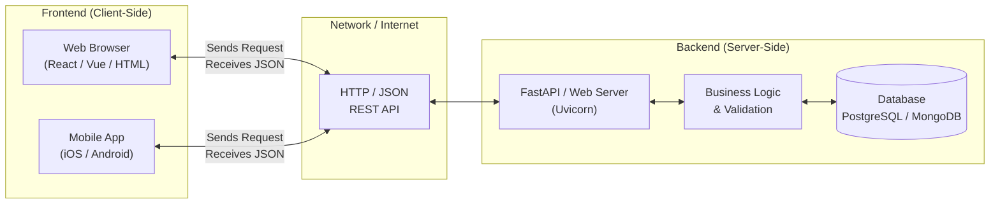
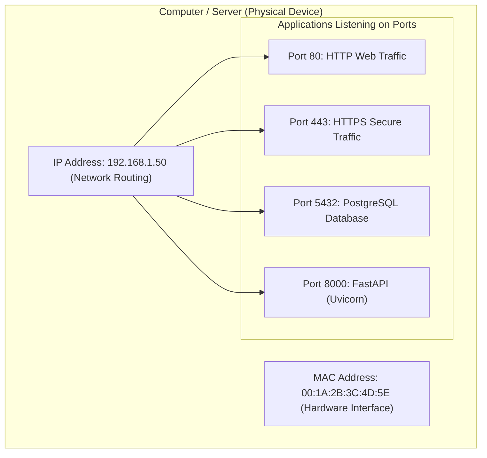
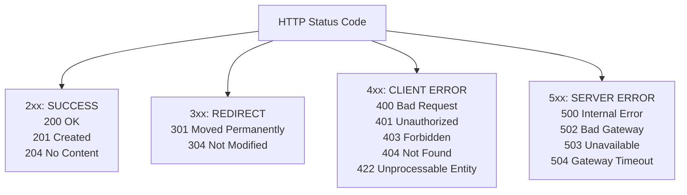
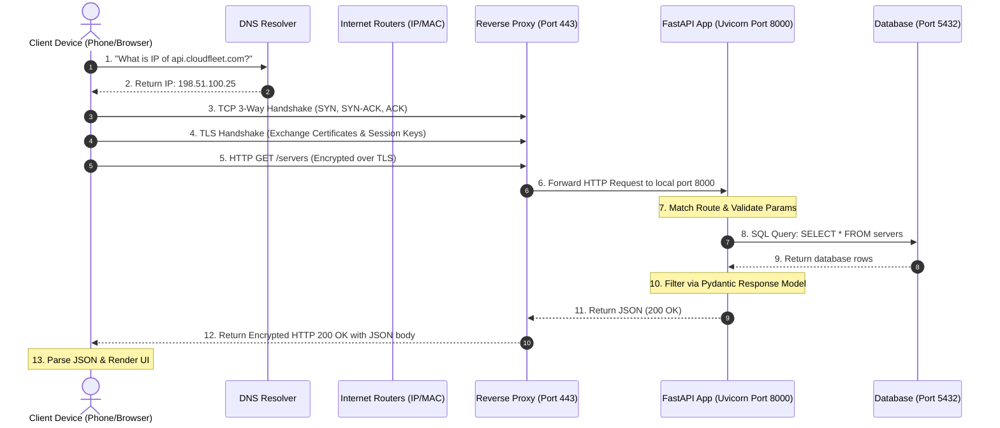

# 00. Networking & Web Fundamentals

Before writing backend code with FastAPI, it is essential to understand the physical and logical infrastructure that makes the web work. When you build an API, you are not writing isolated scripts—you are building software that communicates across global computer networks.

This foundational guide covers how the internet connects devices, what happens when you type a URL or click a button, and the protocols that govern every request and response.

---

## 1. Frontend vs. Backend: The Big Picture

Modern software architectures divide applications into two primary domains: **Frontend** and **Backend**.



### The Restaurant Analogy

* **The Customer & Dining Area (Frontend):** What the user sees, touches, and interacts with (buttons, forms, animations). Runs locally on the user's device (phone, laptop).
* **The Waiter (API):** Takes the customer's order, brings it to the kitchen, and delivers the food back to the table in a standard format.
* **The Kitchen & Pantry (Backend & Database):** Where the actual work happens. Validates ingredients, enforces business rules, prepares data securely, and stores inventory in the database. Customers are never allowed to walk directly into the kitchen!

### Frontend vs. Backend Comparison

| Dimension | Frontend (Client) | Backend (Server) |
| :--- | :--- | :--- |
| **Where it runs** | User's local device (browser, phone) | Remote cloud servers / containers |
| **Technologies** | HTML, CSS, JavaScript, React, Swift, Kotlin | Python (FastAPI), Go, Node.js, databases |
| **Primary focus** | User experience (UI/UX), responsiveness | Business logic, data integrity, security |
| **Security context** | **Untrusted** (anyone can inspect client code) | **Trusted** (holds secret keys, credentials, DB) |

---

## 2. What is an API?

**API** stands for **Application Programming Interface**.

An API is a standardized contract that allows two separate software programs to communicate without knowing how each other is built internally.

* A web application built with **React** can communicate with a backend written in **Python (FastAPI)**.
* An **iOS app** written in **Swift** can fetch data from that exact same Python backend.
* An external partner's system can query the same backend using automated scripts.

All of them exchange structured data in a universal, language-agnostic format: **JSON (JavaScript Object Notation)**.

```json
{
  "user_id": 1042,
  "username": "ahmad_dev",
  "role": "engineer",
  "is_active": true
}
```

---

## 3. Network Identifiers: MAC, IP, and Port

For two devices to exchange data across a network, they need precise addressing. Think of networking addresses like physical postal mail:

```text
MAC Address   ==>   Your Government ID / Fingerprint (Permanent Hardware Identity)
IP Address    ==>   Your Street Address (Where your building is located in the city)
Port Number   ==>   Your Apartment / Room Number (Which specific room inside the building)
```



### 1. MAC Address (Physical Address)

* **What it is:** A 48-bit unique identifier burned directly into the Network Interface Card (NIC) by the manufacturer (e.g., `00:1A:2B:3C:4D:5E`).
* **Scope:** Local Network (Layer 2 - Data Link). Switches use MAC addresses to forward data frames between devices on the same local Wi-Fi or Ethernet switch.

### 2. IP Address (Logical Address)

* **What it is:** A logical address assigned to a device on a network so routers know how to forward packets across the internet (Layer 3 - Network).
* **IPv4 vs. IPv6:**
  * **IPv4:** 32-bit address written in 4 dotted decimal octets: `192.168.1.1` (approx. 4.3 billion addresses, now exhausted).
  * **IPv6:** 128-bit address written in 8 hexadecimal blocks: `2001:0db8:85a3::8a2e:0370:7334`.
* **Public vs. Private IP Addresses:**
  * **Private IPs:** Used inside homes and office networks; cannot be routed directly over the public internet (e.g., `192.168.x.x`, `10.x.x.x`, `172.16.x.x-172.31.x.x`).
  * **Public IPs:** Globally unique addresses assigned by your Internet Service Provider (ISP), visible across the entire internet.
  * **Loopback (`127.0.0.1` / `localhost`):** A special reserved IP pointing directly back to your own computer. Used for local development!

### 3. Port Number (Application Address)

* **What it is:** A 16-bit number ranging from `0` to `65535` that directs network traffic to a specific running program on a machine.
* A single server with one IP address can run a web server, a database, and an email server simultaneously because each service listens on its own distinct **Port**:

| Port Number | Protocol / Service | Description |
| :--- | :--- | :--- |
| **80** | HTTP | Standard unencrypted web traffic |
| **443** | HTTPS | Encrypted secure web traffic |
| **22** | SSH | Secure remote terminal access |
| **53** | DNS | Domain Name System queries |
| **5432** | PostgreSQL | Standard relational database port |
| **27017** | MongoDB | Standard NoSQL document database port |
| **8000** | FastAPI / Uvicorn | Default port for local FastAPI applications |

---

## 4. Web Protocols: DNS, HTTP, and HTTPS

### 1. DNS (Domain Name System): The Internet's Phonebook

Computers only understand IP addresses (like `142.250.190.46`), but humans remember names (like `google.com`).

**DNS** is the distributed global database that translates human-readable domain names into routable IP addresses:

```text
Browser asks:  "What is the IP address for api.myservice.com?"
DNS Server:    "The IP address is 198.51.100.25"
```

### 2. HTTP (Hypertext Transfer Protocol)

**HTTP** is the application protocol that powers the World Wide Web and REST APIs.

* **Client-Server Model:** The client sends an HTTP Request; the server returns an HTTP Response.
* **Stateless:** Every request is independent. The server does not remember previous requests unless you explicitly send a token, cookie, or session identifier.
* **Unencrypted:** Plain HTTP (port 80) sends data in clear text. Anyone on the same public Wi-Fi can inspect the passwords and tokens you send!

### 3. HTTPS (HTTP Secure): Encryption via TLS/SSL

**HTTPS** is HTTP running over an encrypted **TLS** (Transport Layer Security) cryptographic tunnel (port 443).

* **Encryption:** Scrambles data so eavesdroppers only see gibberish.
* **Integrity:** Ensures data cannot be modified in transit by bad actors.
* **Authentication:** Uses digital SSL/TLS certificates issued by trusted Certificate Authorities (CAs) to prove the server is genuinely who it claims to be.

---

## 5. HTTP Request Anatomy & Methods

An HTTP request consists of three main components:

1. **Request Line:** Method, Path, and Protocol version (e.g., `POST /servers HTTP/1.1`).
2. **Headers:** Key-value metadata describing the client, content format, and security tokens.
3. **Body (Payload):** The data being sent to the server (typically JSON).

```http
POST /api/v1/servers HTTP/1.1
Host: api.cloudfleet.com
Content-Type: application/json
Authorization: Bearer eyJhbGciOi...

{
    "hostname": "web-prod-01",
    "ip_address": "10.0.0.12",
    "ram_gb": 32
}
```

### Standard HTTP Methods (CRUD Mapping)

In RESTful APIs, each HTTP method represents a clear operational intent:

| Method | REST Action | Purpose | Has Request Body? | Idempotent? |
| :--- | :--- | :--- | :--- | :--- |
| **GET** | Read | Retrieve a resource or list of resources | ❌ No | ✅ Yes |
| **POST** | Create | Submit data to create a brand new resource | ✅ Yes | ❌ No |
| **PUT** | Replace | Completely overwrite an existing resource | ✅ Yes | ✅ Yes |
| **PATCH** | Update | Partially modify specific fields of a resource | ✅ Yes | ❌ No (usually) |
| **DELETE** | Delete | Remove a resource from the server | ❌ No (rarely) | ✅ Yes |

[!NOTE]
**What is Idempotence?**  
An HTTP method is **idempotent** if making the identical request multiple times produces the exact same outcome on the server.

* `GET /users/5`: Reading user 5 ten times leaves the database unchanged (**Idempotent**).
* `DELETE /users/5`: Deleting user 5 once or ten times results in user 5 being gone (**Idempotent**).
* `POST /orders`: Submitting an order 5 times creates 5 separate orders with 5 credit card charges (**NOT Idempotent**)!

---

## 6. HTTP Response Status Codes

When an API responds, the first line is the **Status Line** containing a three-digit numeric code. Status codes are grouped into five distinct families based on their first digit:

```text
1xx: Informational (Request received, continuing process)
2xx: Success       (Everything went well!)
3xx: Redirection   (Resource moved, go look elsewhere)
4xx: Client Error  (The client made a mistake)
5xx: Server Error  (The server crashed or failed)
```



### The Most Important Codes for Backend Engineers

| Code | Name | Meaning | When to Use in FastAPI |
| :--- | :--- | :--- | :--- |
| **`200`** | **OK** | The request was successful. | Standard response for `GET`, `PUT`, `PATCH`. |
| **`201`** | **Created** | A new resource was successfully created. | Standard response for successful `POST`. |
| **`204`** | **No Content** | Succeeded, but there is no body to return. | Standard response for successful `DELETE`. |
| **`301`** | **Moved Permanently** | URL has permanently changed. | Redirecting legacy API endpoints. |
| **`304`** | **Not Modified** | Client cached copy is still fresh. | HTTP caching mechanisms. |
| **`400`** | **Bad Request** | Malformed request or broken syntax. | Client sent raw text instead of JSON. |
| **`401`** | **Unauthorized** | Missing or invalid authentication token. | User is not logged in (`Invalid Token`). |
| **`403`** | **Forbidden** | User is known, but lacks permission. | Regular user trying to access admin routes. |
| **`404`** | **Not Found** | The requested resource does not exist. | Querying for a server ID that doesn't exist. |
| **`422`** | **Unprocessable Entity** | Syntactically valid JSON, but failed validation. | **FastAPI's signature code** when Pydantic fails validation! |
| **`500`** | **Internal Server Error** | Unhandled exception or bug in server code. | Python script threw an unhandled crash. |
| **`502`** | **Bad Gateway** | Gateway/Proxy received invalid upstream reply. | Nginx cannot talk to Uvicorn (app is down). |
| **`503`** | **Service Unavailable** | Server overloaded or down for maintenance. | Out of memory, high traffic spike. |
| **`504`** | **Gateway Timeout** | Upstream server took too long to reply. | Database query took 60+ seconds and timed out. |

---

## 7. The Journey of a Web Request: Step-by-Step

What actually happens under the hood when a user visits `https://api.cloudfleet.com/servers` on their phone or laptop?



### The 8 Key Milestones

1. **DNS Resolution:**
   The browser checks its cache, OS cache, and recursive DNS servers until it translates `api.cloudfleet.com` to the server's public IP address `198.51.100.25`.
2. **TCP 3-Way Handshake (Connection Establishment):**
   Before sending any data, the client and server establish a reliable connection using Transmission Control Protocol (TCP):
   * **SYN:** Client asks, *"Can we communicate?"*
   * **SYN-ACK:** Server responds, *"Yes, I am listening."*
   * **ACK:** Client confirms, *"Great, let's begin."*
3. **TLS Handshake (Security Negotiation):**
   For HTTPS, the client validates the server's digital SSL certificate and securely negotiates a shared symmetric encryption key.
4. **Sending the HTTP Request:**
   The client formats an HTTP request line (`GET /servers HTTP/1.1`), attaches headers (like `Authorization: Bearer ...`), and transmits the packets across intermediate routers using IP addresses.
5. **Reverse Proxy (Nginx) Forwarding:**
   The server's physical network card (MAC address) receives the packets. A reverse proxy (like Nginx) listening on port `443` decrypts the TLS traffic and forwards the request internally to FastAPI/Uvicorn on port `8000`.
6. **FastAPI Processing (Application Layer):**
   * **Router:** Matches the path `/servers` and method `GET`.
   * **Dependencies:** Checks authentication and opens a database session.
   * **Validation:** Validates query/path parameters using Pydantic.
   * **Business Logic:** Queries PostgreSQL/MongoDB and gathers records.
7. **FastAPI Response Serialization:**
   FastAPI filters the result through the defined `response_model`, converts Python dictionaries/objects into raw JSON text, and appends headers (`Content-Type: application/json`).
8. **Client Rendering:**
   The client receives the `HTTP/1.1 200 OK` response along with the JSON payload. The frontend updates its UI state, displaying the list of servers to the user.

---

## 8. Summary: How This Connects to FastAPI

Everything you do in FastAPI directly controls these networking fundamentals:

* Writing `@app.get("/items")` $\rightarrow$ Tells Uvicorn which **HTTP Method** and **URL Path** to listen for.
* Defining `status_code=201` $\rightarrow$ Sets the **HTTP Status Code** returned to the client.
* Raising `HTTPException(status_code=404)` $\rightarrow$ Returns a standardized **Client Error Status Code**.
* Subclassing `BaseModel` $\rightarrow$ Validates the incoming **Request Body JSON** and triggers an automatic **`422 Unprocessable Entity`** error if invalid.
* Configuring `CORSMiddleware` $\rightarrow$ Configures **HTTP Headers** so browsers permit frontend cross-origin requests.
