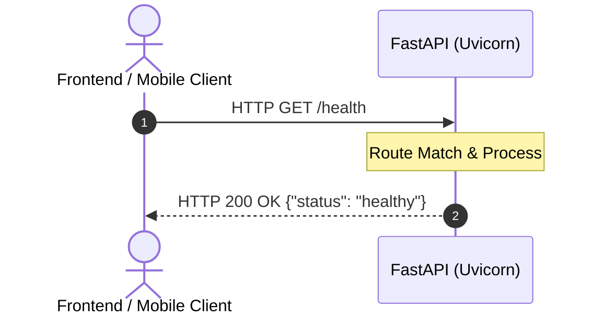

# 01. FastAPI Fundamentals: The First Endpoint

Welcome to the foundation of modern Python backend web development. In this lesson, you will learn what an API is, how FastAPI handles network requests, and how to write and run your first production-ready web endpoint.

---

## 1. What is an API and REST?

An **API** (Application Programming Interface) allows two software programs to communicate over a network using the **HTTP** (Hypertext Transfer Protocol) protocol.

In **REST** (Representational State Transfer) architecture:

* The **Client** (browser, mobile app, or another server) sends an **HTTP Request** to a specific URL (Endpoint).
* The **Server** processes the request and sends back an **HTTP Response** (typically formatted as JSON) containing a **Status Code** and data.



---

## 2. ASGI vs. WSGI: The Speed Secret

Older Python web frameworks (like Flask and traditional Django) rely on **WSGI** (Web Server Gateway Interface). WSGI is synchronous: it handles one request per thread at a time, creating bottlenecks under high traffic.

FastAPI is built on **ASGI** (Asynchronous Server Gateway Interface):

* Driven by **Starlette** (lightweight async web foundation) and **Uvicorn** (lightning-fast ASGI web server).
* Natively supports asynchronous non-blocking concurrent I/O (`async` / `await`).
* Capable of handling thousands of concurrent requests per second on a single machine.

---

## 3. Installation

To get started, install FastAPI and the Uvicorn ASGI server:

```bash
pip install "fastapi[standard]"
```

*(The `[standard]` flag bundles Uvicorn, standard email/multipart parsers, and performance enhancements).*

---

## 4. Writing Your First API

Create a file named `main.py` and write the following code:

```python
from fastapi import FastAPI, status

# 1. Initialize the FastAPI application instance
app = FastAPI(
    title="Fleet Management API",
    description="A modern backend API for managing network infrastructure and devices.",
    version="1.0.0"
)

# 2. Define a Path Operation Decorator and Function
@app.get("/", status_code=status.HTTP_200_OK)
def read_root():
    """Root endpoint welcoming clients to the API service."""
    return {"message": "Welcome to the Fleet Management API", "status": "online"}

@app.get("/health", status_code=status.HTTP_200_OK)
def health_check():
    """Health check endpoint used by load balancers and container orchestrators."""
    return {"status": "healthy", "service": "fleet-api", "version": "1.0.0"}
```

### Deconstructing the Code

* **`app = FastAPI(...)`**: The central application object that coordinates routing, middleware, and documentation.
* **`@app.get(...)`**: The **Path Operation Decorator**.
  * `.get`: The HTTP method (used to read or retrieve data).
  * `"/"`: The URL path (endpoint).
  * `status_code=status.HTTP_200_OK`: Explicitly defines the standard HTTP status code returned upon success.
* **`def read_root():`**: The **Path Operation Function**. Whenever a client issues a `GET /` request, FastAPI automatically executes this function and serializes its return value (a Python dictionary) into standard JSON.

---

## 5. Running the Application with Uvicorn

In your terminal, navigate to the folder containing `main.py` and run:

```bash
uvicorn main:app --reload
```

### Breakdown of the CLI Command

* **`main`**: The name of the Python file (`main.py`).
* **`app`**: The variable name of the `FastAPI()` instance created inside `main.py`.
* **`--reload`**: Automatically restarts the server whenever code changes are saved on disk (essential for local development!).

You will see terminal output similar to:

```text
INFO:     Uvicorn running on http://127.0.0.1:8000 (Press CTRL+C to quit)
INFO:     Started reloader process
INFO:     Application startup complete.
```

Open your browser and visit: `http://127.0.0.1:8000/`. You will see the live JSON response:

```json
{
  "message": "Welcome to the Fleet Management API",
  "status": "online"
}
```

---

## 6. Interactive Documentation (Swagger UI & ReDoc)

One of FastAPI's greatest superpowers is **automatic OpenAPI documentation**. Without writing a single line of manual HTML or Markdown, FastAPI inspects your Python code and type annotations to generate two live interactive documentation interfaces:

1. **Swagger UI (`http://127.0.0.1:8000/docs`):**  
   An interactive web dashboard where you can see all endpoints, inspect required schemas, and click **"Try it out"** to send real HTTP requests directly from your browser!
2. **ReDoc (`http://127.0.0.1:8000/redoc`):**  
   A clean, professional, publication-ready documentation view favored for technical reference guides.

---

## 7. HTTP Methods Overview

In RESTful design, different HTTP verbs declare the intent of an operation:

| HTTP Method | FastAPI Decorator | Primary Purpose | Example Scenario |
| :--- | :--- | :--- | :--- |
| **GET** | `@app.get()` | Retrieve or read data | `GET /devices` (List all devices) |
| **POST** | `@app.post()` | Create new records | `POST /devices` (Register a new device) |
| **PUT** | `@app.put()` | Replace an entire record | `PUT /devices/12` (Update full device config) |
| **PATCH** | `@app.patch()` | Partially update a record | `PATCH /devices/12` (Update only the IP address) |
| **DELETE** | `@app.delete()` | Remove a record | `DELETE /devices/12` (Delete device) |

---

## 8. Common Gotchas to Avoid

* **Forgetting `--reload` in Development:** If you edit `main.py` and don't see your changes reflected in the browser, verify that you launched Uvicorn with `--reload`.
* **Blocking Async Calls:** If you declare a path operation as `async def my_endpoint():`, never run long blocking synchronous calls (like `time.sleep()` or non-async database drivers) directly inside it. Use standard `def` for synchronous blocking tasks, or use `asyncio.sleep()` for asynchronous tasks.
