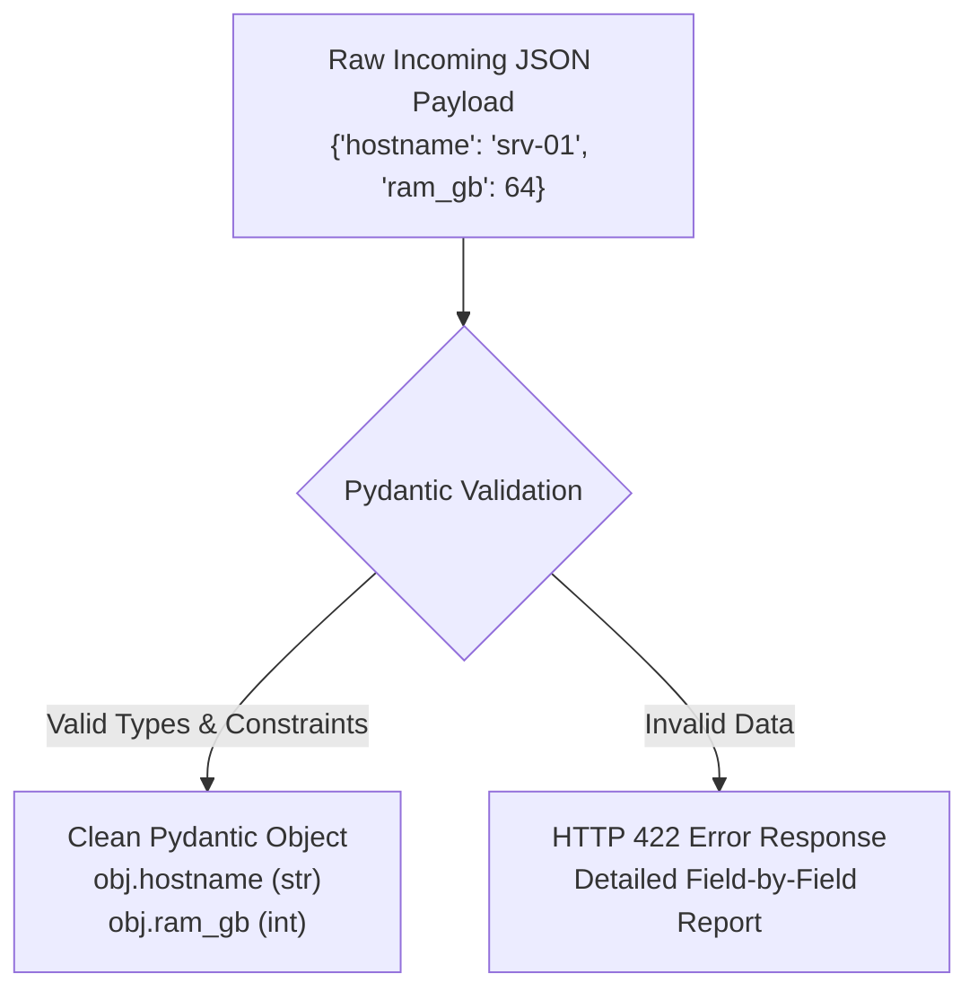

# 03. Request Body & Pydantic Data Models

When creating or modifying data in a backend application (using `POST`, `PUT`, or `PATCH`), clients send data packaged as a JSON payload inside the **HTTP Request Body**.

FastAPI uses **Pydantic** to declare, parse, and validate request bodies with complete type safety.

---

## 1. What is Pydantic?

**Pydantic** is the leading Python data validation library. Instead of writing dozens of manual `if` statements to check if incoming data has the right fields, types, and constraints, you define a **Schema** by subclassing `pydantic.BaseModel`.



---

## 2. Declaring a Request Body

To receive a request body, declare a Pydantic model and type-hint your endpoint parameter with that model:

```python
from fastapi import FastAPI, status
from pydantic import BaseModel

app = FastAPI()

# 1. Define the schema of the incoming data
class ServerCreate(BaseModel):
    hostname: str
    ip_address: str
    cpu_cores: int
    ram_gb: int
    is_active: bool = True  # Optional field with default value

# 2. Use the model in a POST route
@app.post("/servers", status_code=status.HTTP_201_CREATED)
def create_server(server: ServerCreate):
    """Register a new server in the fleet."""
    # 'server' is already a fully validated Python object!
    print(f"Provisioning server: {server.hostname} with {server.ram_gb}GB RAM")
    
    # You can access attributes directly with dot notation
    # or convert it back to a standard Python dictionary:
    server_dict = server.model_dump()
    return {"message": "Server created successfully", "data": server_dict}
```

### What Happens Automatically

1. **JSON Parsing:** FastAPI reads the raw HTTP request body and parses the JSON.
2. **Type Coercion:** If `cpu_cores` arrives as `"16"` (a string), Pydantic safely converts it to the integer `16`.
3. **Validation & Errors:** If required fields like `hostname` are missing, FastAPI immediately stops execution and returns a 422 error detailing the missing field.
4. **Documentation:** The model schema is automatically published to Swagger UI (`/docs`), giving API consumers a full JSON example and interactive form!

---

## 3. Advanced Field Constraints with `Field(...)`

To enforce granular business rules (e.g., maximum string lengths, minimum numeric values, or custom regex formats), use `Field` from `pydantic`:

```python
from pydantic import BaseModel, Field

class NetworkInterface(BaseModel):
    name: str = Field(
        ...,
        min_length=2,
        max_length=15,
        description="Interface identifier (e.g., eth0, enp3s0)"
    )
    mtu: int = Field(
        default=1500,
        ge=576,
        le=9000,
        description="Maximum Transmission Unit in bytes"
    )
    mac_address: str = Field(
        ...,
        pattern=r"^([0-9A-Fa-f]{2}[:-]){5}([0-9A-Fa-f]{2})$",
        description="Standard 6-byte hexadecimal MAC address",
        examples=["00:1A:2B:3C:4D:5E"]
    )
```

---

## 4. Nested Pydantic Models: Hierarchical Data

Real-world JSON is rarely flat. It often contains nested objects and lists. Pydantic supports arbitrarily deep nesting by using models as field types:

```python
from pydantic import BaseModel, Field

# Child model 1
class PortSpec(BaseModel):
    port_number: int = Field(..., ge=1, le=65535)
    protocol: str = Field(default="TCP")

# Child model 2
class HardwareSpec(BaseModel):
    architecture: str = "x86_64"
    disk_gb: int = Field(..., gt=0)
    open_ports: list[PortSpec] = Field(default_factory=list)

# Parent model
class ServerDeploy(BaseModel):
    hostname: str
    datacenter: str
    hardware: HardwareSpec  # Nested Pydantic Model!
    tags: list[str] = []
```

### Incoming JSON Example Handled by `ServerDeploy`

```json
{
  "hostname": "prod-gateway-01",
  "datacenter": "us-east-1",
  "hardware": {
    "architecture": "ARM64",
    "disk_gb": 500,
    "open_ports": [
      {"port_number": 80, "protocol": "TCP"},
      {"port_number": 443, "protocol": "TCP"}
    ]
  },
  "tags": ["production", "edge-router"]
}
```

---

## 5. Combining Path Parameters, Query Parameters & Request Body

FastAPI knows how to differentiate between parameters based on how they are defined:

* In the **URL path** (`{id}`) $\rightarrow$ **Path Parameter**
* Of **primitive type** (`int`, `str`, `bool`) not in path $\rightarrow$ **Query Parameter**
* Of **Pydantic Model** type $\rightarrow$ **Request Body**

```python
from fastapi import FastAPI, Path, Query
from pydantic import BaseModel

app = FastAPI()

class ServerUpdate(BaseModel):
    hostname: str | None = None
    is_active: bool | None = None

@app.patch("/servers/{server_id}")
def update_server(
    server_id: int = Path(..., ge=1),           # Path parameter
    notify_admin: bool = Query(default=False),   # Query parameter (?notify_admin=true)
    payload: ServerUpdate = ...                 # Request Body (JSON)
):
    return {
        "server_id": server_id,
        "notified": notify_admin,
        "updated_fields": payload.model_dump(exclude_unset=True)
    }
```

---

## 6. Pro-Tip: `exclude_unset=True`

When performing partial updates (`PATCH`), always use `.model_dump(exclude_unset=True)`:

* It dumps **only the fields that the client explicitly sent** in the request, omitting any default values that were not supplied. This prevents accidentally overwriting existing database fields with default values!
