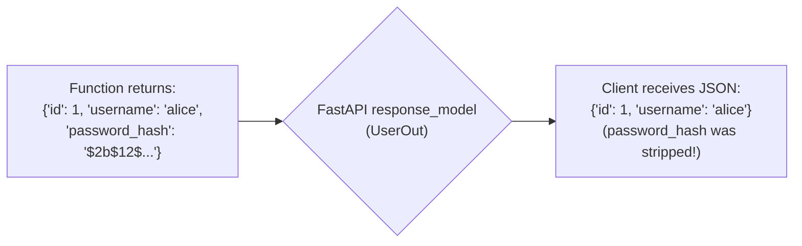

# 04. RESTful CRUD & Response Models

The vast majority of web applications revolve around four fundamental actions known as **CRUD**:

* **C**reate (`POST`)
* **R**ead (`GET`)
* **U**pdate (`PUT` / `PATCH`)
* **D**elete (`DELETE`)

In this lesson, you will build a complete, production-grade CRUD service, learn how to handle errors safely using `HTTPException`, and use **Response Models** to protect sensitive data from leaking to clients.

---

## 1. REST Status Code Standards

Using accurate HTTP status codes is essential for building professional APIs that frontend clients and third-party consumers can trust:

| Action | HTTP Verb | Success Status Code | Failure Status Code |
| :--- | :--- | :--- | :--- |
| **Create** | `POST` | `201 Created` | `400 Bad Request` / `422 Validation Error` |
| **Read (List / Single)** | `GET` | `200 OK` | `404 Not Found` |
| **Full Replace** | `PUT` | `200 OK` | `404 Not Found` / `422 Validation Error` |
| **Partial Update** | `PATCH` | `200 OK` | `404 Not Found` / `422 Validation Error` |
| **Delete** | `DELETE` | `204 No Content` | `404 Not Found` |

---

## 2. Handling Errors with `HTTPException`

When a requested resource cannot be found or a business rule is violated, you should never let Python throw an unhandled crash or return a generic 200 OK with an error message inside the body.

Use `HTTPException` to interrupt execution immediately and return a clean, standard HTTP error:

```python
from fastapi import FastAPI, HTTPException, status

app = FastAPI()

fake_database = {1: "Router Alpha", 2: "Switch Beta"}

@app.get("/items/{item_id}")
def read_item(item_id: int):
    if item_id not in fake_database:
        # Halt execution and return HTTP 404
        raise HTTPException(
            status_code=status.HTTP_404_NOT_FOUND,
            detail=f"Resource with ID {item_id} does not exist."
        )
    return {"id": item_id, "name": fake_database[item_id]}
```

---

## 3. Response Models & Data Filtering

A common backend security flaw is inadvertently exposing sensitive internal data (like passwords, secret keys, or internal database metadata) in API responses.

FastAPI solves this with **`response_model`**. When declared on a route, FastAPI filters the returned data through that schema, guaranteeing that only the fields defined in the response model are serialized to the client:



```python
from pydantic import BaseModel, EmailStr

# 1. Incoming payload schema (Contains sensitive plaintext password)
class UserCreate(BaseModel):
    username: str
    email: str
    password: str

# 2. Outgoing public response schema (NO password or sensitive fields!)
class UserResponse(BaseModel):
    id: int
    username: str
    email: str
    is_active: bool
```

---

## 4. Complete Working Example: Device Management CRUD

Here is a complete, working CRUD application illustrating all 5 standard routes, status codes, exception handling, and response models:

```python
from fastapi import FastAPI, HTTPException, status, Path
from pydantic import BaseModel, Field

app = FastAPI(title="Device Fleet API")

# --- Schemas ---
class DeviceBase(BaseModel):
    hostname: str = Field(..., min_length=2, max_length=50)
    ip_address: str
    device_type: str = "switch"

class DeviceCreate(DeviceBase):
    pass

class DeviceUpdate(BaseModel):
    hostname: str | None = None
    ip_address: str | None = None
    device_type: str | None = None

class DeviceResponse(DeviceBase):
    id: int
    is_active: bool

# --- In-Memory Database State ---
db: dict[int, dict] = {
    1: {"id": 1, "hostname": "core-rtr-01", "ip_address": "10.0.0.1", "device_type": "router", "is_active": True},
    2: {"id": 2, "hostname": "dist-sw-01", "ip_address": "10.0.1.1", "device_type": "switch", "is_active": True}
}
current_id = 2


# 1. CREATE (POST) -> 201 Created
@app.post("/devices", response_model=DeviceResponse, status_code=status.HTTP_201_CREATED)
def create_device(payload: DeviceCreate):
    global current_id
    current_id += 1
    new_device = {
        "id": current_id,
        "is_active": True,
        **payload.model_dump()
    }
    db[current_id] = new_device
    return new_device


# 2. READ ALL (GET) -> 200 OK
@app.get("/devices", response_model=list[DeviceResponse])
def get_all_devices():
    return list(db.values())


# 3. READ SINGLE (GET) -> 200 OK (or 404)
@app.get("/devices/{device_id}", response_model=DeviceResponse)
def get_device(device_id: int = Path(..., ge=1)):
    if device_id not in db:
        raise HTTPException(
            status_code=status.HTTP_404_NOT_FOUND,
            detail=f"Device with ID {device_id} not found."
        )
    return db[device_id]


# 4. PARTIAL UPDATE (PATCH) -> 200 OK (or 404)
@app.patch("/devices/{device_id}", response_model=DeviceResponse)
def update_device(payload: DeviceUpdate, device_id: int = Path(..., ge=1)):
    if device_id not in db:
        raise HTTPException(
            status_code=status.HTTP_404_NOT_FOUND,
            detail=f"Device with ID {device_id} not found."
        )
    
    update_data = payload.model_dump(exclude_unset=True)
    db[device_id].update(update_data)
    return db[device_id]


# 5. DELETE (DELETE) -> 204 No Content (or 404)
@app.delete("/devices/{device_id}", status_code=status.HTTP_204_NO_CONTENT)
def delete_device(device_id: int = Path(..., ge=1)):
    if device_id not in db:
        raise HTTPException(
            status_code=status.HTTP_404_NOT_FOUND,
            detail=f"Device with ID {device_id} not found."
        )
    del db[device_id]
    return None  # 204 No Content response bodies must be empty!
```

---

## 5. Summary Checklist

* Use **`status_code`** on decorators to explicitly declare HTTP outcomes (`201` for creations, `204` for deletions).
* Use **`HTTPException`** whenever a request cannot be fulfilled as requested (`404` for missing IDs).
* Use **`response_model`** to enforce security and clean API contracts on all responses.
