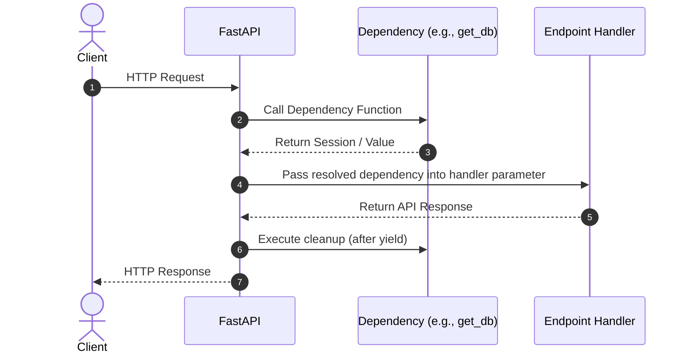

# 05. Dependency Injection System

In software engineering, **Dependency Injection (DI)** is a design pattern where an object or function receives other objects that it depends on, rather than creating them internally.

FastAPI includes one of the most powerful and intuitive dependency injection systems ever built into a web framework. It allows you to:

* Share database connections across routes with guaranteed teardown.
* Enforce security and role-based permissions cleanly.
* Avoid code duplication (DRY) for pagination, headers, and authentication.

---

## 1. How FastAPI Dependency Injection Works

You declare a Python function or class that performs a task (e.g., validating a token or opening a database connection), and declare it in your route using `Depends`:



---

## 2. A Basic Dependency: Common Query Parameters

Instead of repeating `skip: int = 0, limit: int = 20` on every single listing endpoint in your application, extract them into a reusable dependency:

```python
from fastapi import FastAPI, Depends

app = FastAPI()

# 1. Define the Dependency Function
def common_pagination_params(skip: int = 0, limit: int = 10):
    """Parses, validates, and provides standard pagination limits."""
    return {"skip": skip, "limit": limit}

# 2. Inject it into route functions using Depends()
@app.get("/items")
def list_items(pagination: dict = Depends(common_pagination_params)):
    return {
        "message": "Listing items",
        "skip": pagination["skip"],
        "limit": pagination["limit"]
    }

@app.get("/users")
def list_users(pagination: dict = Depends(common_pagination_params)):
    return {
        "message": "Listing users",
        "skip": pagination["skip"],
        "limit": pagination["limit"]
    }
```

Notice how clean the route handlers are! FastAPI automatically inspects `common_pagination_params`, extracts the query parameters from the request, validates them, and passes the resulting dictionary directly into `pagination`.

---

## 3. Classes as Dependencies

You can also use Python classes directly as dependencies. When you use a class, FastAPI automatically instantiates the class using the request parameters:

```python
class Pagination:
    def __init__(self, skip: int = 0, limit: int = 25):
        self.skip = skip
        self.limit = limit

@app.get("/logs")
# Shortcut: Depends(Pagination) or simply Depends() when type is specified!
def get_system_logs(pager: Pagination = Depends()):
    return {"skip": pager.skip, "limit": pager.limit}
```

---

## 4. Dependencies with `yield`: Guaranteed Cleanup

The most critical use case for dependency injection is managing resources that must be safely closed after the request completes (such as **database connections**, transactions, or file locks).

FastAPI supports dependencies with `yield`:

* Any code **before** the `yield` statement runs *before* your endpoint executes.
* The value yielded is passed into your endpoint function.
* Any code **after** the `yield` statement is guaranteed to run *after* the endpoint finishes (even if an exception was raised!).

```python
from fastapi import FastAPI, Depends

app = FastAPI()

# Simulated Database Session Manager
class FakeDBSession:
    def __init__(self):
        print("🔌 [DB] Connection opened.")

    def close(self):
        print("🔒 [DB] Connection safely closed.")

# Dependency function with yield
def get_db():
    db = FakeDBSession()
    try:
        # 1. Provide the active connection to the route
        yield db
    finally:
        # 2. Always runs when the HTTP response has been sent!
        db.close()


@app.get("/records")
def read_records(db: FakeDBSession = Depends(get_db)):
    print("⚡ Executing query inside the endpoint...")
    return {"status": "success", "data": [1, 2, 3]}
```

**Terminal Output when a request arrives:**

```text
🔌 [DB] Connection opened.
⚡ Executing query inside the endpoint...
🔒 [DB] Connection safely closed.
```

---

## 5. Sub-Dependencies (Hierarchical Dependency Trees)

Dependencies can depend on other dependencies! FastAPI automatically resolves the entire dependency graph:

```python
def get_db():
    yield "ActiveDatabaseSession"

def get_current_user(db = Depends(get_db)):
    # Uses the database dependency to look up the user
    return {"user_id": 99, "role": "admin"}

@app.get("/dashboard")
def view_dashboard(user = Depends(get_current_user)):
    return {"welcome": f"Hello User #{user['user_id']}"}
```

---

## 6. Global & Router-Level Dependencies

If an entire collection of endpoints requires authentication or a header check, you do not need to add `Depends()` to every single route individually. You can apply dependencies at the `app` or `APIRouter` level:

```python
from fastapi import FastAPI, Depends, Header, HTTPException, status

def verify_api_key(x_api_key: str = Header(...)):
    if x_api_key != "secret-token-123":
        raise HTTPException(status_code=status.HTTP_403_FORBIDDEN, detail="Invalid API Key")

# Applied globally to ALL routes in the application:
app = FastAPI(dependencies=[Depends(verify_api_key)])
```
