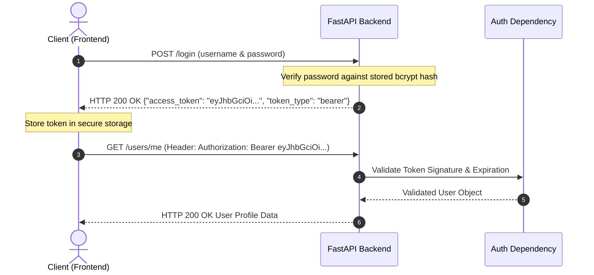

# 07. Authentication & Security (JWT)

Securing endpoints and managing user identity is one of the most critical responsibilities of any backend engineer.

Modern APIs use **stateless, token-based authentication** with **JSON Web Tokens (JWT)**. In this lesson, you will learn how password hashing works, how to generate and verify JWTs, and how to protect sensitive routes using FastAPI's security utilities.

---

## 1. How JWT Authentication Works



---

## 2. Dependencies & Installation

To implement modern security and token encryption in Python, install `PyJWT` and `pwdlib` / `passlib` with `bcrypt`:

```bash
pip install "PyJWT>=2.8.0" "passlib[bcrypt]>=1.7.4"
```

---

## 3. Password Hashing with Bcrypt

Never store passwords in plain text! Always store an irreversible cryptographic hash:

```python
from passlib.context import CryptContext

# Configure passlib to use the industry-standard bcrypt algorithm
pwd_context = CryptContext(schemes=["bcrypt"], deprecated="auto")

def hash_password(password: str) -> str:
    """Hashes a plaintext password."""
    return pwd_context.hash(password)

def verify_password(plain_password: str, hashed_password: str) -> bool:
    """Verifies a plaintext password against a stored bcrypt hash."""
    return pwd_context.verify(plain_password, hashed_password)

# Demonstration:
hashed = hash_password("SuperSecret123!")
print("Stored Hash:", hashed)
# Outputs: $2b$12$K89e5YwzN5vH...

print(verify_password("SuperSecret123!", hashed))  # True
print(verify_password("WrongPassword", hashed))    # False
```

---

## 4. Generating and Decoding JWT Tokens

A JWT contains signed metadata (claims) such as the user identity (`sub`) and an expiration timestamp (`exp`):

```python
import jwt
from datetime import datetime, timedelta, timezone

# In production, store this in an environment variable!
SECRET_KEY = "super-secret-key-change-this-in-production"
ALGORITHM = "HS256"
ACCESS_TOKEN_EXPIRE_MINUTES = 30

def create_access_token(data: dict, expires_delta: timedelta | None = None) -> str:
    """Encodes a signed JWT access token."""
    to_encode = data.copy()
    expire = datetime.now(timezone.utc) + (expires_delta or timedelta(minutes=ACCESS_TOKEN_EXPIRE_MINUTES))
    to_encode.update({"exp": expire})
    
    encoded_jwt = jwt.encode(to_encode, SECRET_KEY, algorithm=ALGORITHM)
    return encoded_jwt
```

---

## 5. Protecting Routes: The `get_current_user` Dependency

FastAPI provides `OAuth2PasswordBearer` to automatically extract the bearer token from the incoming `Authorization: Bearer <token>` HTTP header:

```python
from fastapi import FastAPI, Depends, HTTPException, status
from fastapi.security import OAuth2PasswordBearer, OAuth2PasswordRequestForm
import jwt

app = FastAPI(title="Secure API")

# Tells FastAPI that clients obtain tokens by sending credentials to /login
oauth2_scheme = OAuth2PasswordBearer(tokenUrl="login")

# Simulated User Store
FAKE_USERS_DB = {
    "alice": {
        "username": "alice",
        "email": "alice@company.com",
        "hashed_password": hash_password("alicepassword"),
        "role": "admin"
    }
}

# Dependency: Extract and validate the token on incoming requests
def get_current_user(token: str = Depends(oauth2_scheme)):
    credentials_exception = HTTPException(
        status_code=status.HTTP_401_UNAUTHORIZED,
        detail="Could not validate credentials",
        headers={"WWW-Authenticate": "Bearer"},
    )
    try:
        payload = jwt.decode(token, SECRET_KEY, algorithms=[ALGORITHM])
        username: str = payload.get("sub")
        if username is None:
            raise credentials_exception
    except jwt.PyJWTError:
        raise credentials_exception

    user = FAKE_USERS_DB.get(username)
    if user is None:
        raise credentials_exception
    return user


# 1. Login Route: Issue JWT tokens
@app.post("/login")
def login(form_data: OAuth2PasswordRequestForm = Depends()):
    user = FAKE_USERS_DB.get(form_data.username)
    if not user or not verify_password(form_data.password, user["hashed_password"]):
        raise HTTPException(
            status_code=status.HTTP_401_UNAUTHORIZED,
            detail="Incorrect username or password"
        )
    
    access_token = create_access_token(data={"sub": user["username"], "role": user["role"]})
    return {"access_token": access_token, "token_type": "bearer"}


# 2. Protected Route: Requires a valid JWT token!
@app.get("/users/me")
def read_current_user(current_user: dict = Depends(get_current_user)):
    """Only accessible with a valid Bearer token!"""
    return {
        "username": current_user["username"],
        "email": current_user["email"],
        "role": current_user["role"]
    }
```

---

## 6. Testing in Swagger UI (The Green Lock 🔒)

When you open `http://127.0.0.1:8000/docs`:

1. You will see a green **Authorize** button at the top right of the Swagger UI page.
2. Clicking it opens a modal where you enter your username (`alice`) and password (`alicepassword`).
3. Swagger UI will automatically call `/login`, store the bearer token, and append the `Authorization: Bearer <token>` header to all subsequent test requests!
