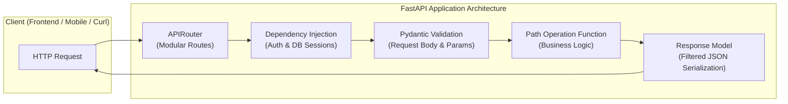

# Module 06: Building APIs with FastAPI

Welcome to Module 06! Up to this point, our Python code has run locally in the terminal. Now, we take the crucial leap into **modern backend web infrastructure**.

In the modern software landscape, mobile applications, web frontends (React, Vue, Next.js), IoT devices, and microservices all communicate across the internet using **RESTful APIs** (Application Programming Interfaces).

**FastAPI** is a modern, high-performance web framework for building APIs with Python 3.8+ based on standard Python type hints. It is currently one of the fastest and most popular web frameworks in the world, utilized by companies like Microsoft, Uber, Netflix, and Cisco.

---

## 🌟 Why FastAPI?

* **⚡ Ultra High Performance:** On par with **Node.js** and **Go**, thanks to Starlette and Pydantic under the hood.
* **📝 Automatic Interactive Documentation:** Generates interactive Swagger UI (`/docs`) and ReDoc (`/redoc`) API documentation out of the box with zero manual documentation writing.
* **🛡️ Bulletproof Data Validation:** Automatic request validation, serialization, and error handling powered by Pydantic.
* **🧩 Intuitive Dependency Injection:** A built-in, highly extensible dependency injection system for database sessions, authentication, and security.
* **✨ Modern Asynchronous Architecture:** Full support for Python `async` / `await` concurrent execution.

---

## 🗺️ Module Architecture & Topics Covered

### Subtopics in This Module

* **[1. FastAPI Fundamentals: The First Endpoint](./01_FastAPI_Fundamentals/)**  
  Understanding ASGI vs. WSGI, installing FastAPI & Uvicorn, creating your first app, HTTP methods, and exploring the automatic Swagger documentation (`/docs`).

* **[2. Path and Query Parameters](./02_Path_and_Query_Parameters/)**  
  Extracting dynamic values from URLs, parameter type validation, optional vs. required parameters, and advanced constraints with `Path(...)` and `Query(...)`.

* **[3. Request Body & Pydantic Data Models](./03_Request_Body_and_Pydantic/)**  
  Receiving and validating JSON payloads with Pydantic `BaseModel`, field constraints with `Field(...)`, nested models, and combining path, query, and body in single endpoints.

* **[4. RESTful CRUD & Response Models](./04_CRUD_Operations_and_Response_Models/)**  
  Architecting full Create, Read, Update, Delete (CRUD) endpoints, status codes, raising exceptions with `HTTPException`, and output filtering via `response_model`.

* **[5. Dependency Injection System](./05_Dependency_Injection/)**  
  Mastering FastAPI's signature `Depends()` pattern: sharing logic across routes, database session management with `yield`, security checks, and code reuse.

* **[6. Application Structuring, APIRouter & CORS](./06_Routers_and_Middleware/)**  
  Organizing production codebases using `APIRouter` across multiple files, configuring Cross-Origin Resource Sharing (`CORSMiddleware`) for web frontends, and custom middlewares.

* **[7. Authentication & Security (JWT)](./07_Authentication_and_Security/)**  
  Password hashing with bcrypt, OAuth2 password flow, generating and verifying JSON Web Tokens (JWT), and protecting endpoints with authentication dependencies.
